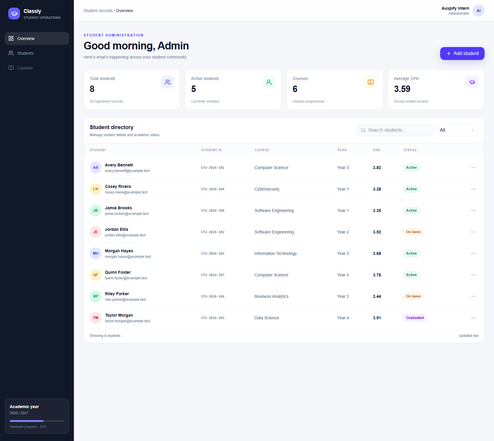

<div align="center">

# Classly

### A clear, responsive workspace for student records.

Student administration MVP built with React, TypeScript, and Cloudflare D1.

<a href="screenshots/task-2-classly/README.md">Explore all 20 feature screenshots</a>

</div>



## What it does

Classly brings everyday student-record tasks into one dashboard: browse a directory, find records, review academic status, and manage student details. The interface adapts to desktop and mobile layouts, with feedback for loading, empty, validation, and confirmation states.

### Highlights

- Create, edit, and delete student records
- Search by student name, student ID, email, or course
- Filter the directory by Active, On leave, or Graduated status
- Review student, active-enrolment, course, and GPA summary cards
- Validate required fields and prevent duplicate student IDs and email addresses
- Use responsive layouts, a scrollable mobile directory, and delete confirmation

## Built with

| Area | Technology |
| --- | --- |
| UI | React 19, TypeScript, Tailwind CSS 4 |
| App framework | Vinext with a Next-compatible App Router |
| Runtime | Cloudflare Workers |
| Data | Cloudflare D1, SQLite, Drizzle ORM |
| API | App Router route handlers |

## Run locally

**Prerequisites:** Node.js 22.13 or newer and npm.

Install the locked dependencies and build the Worker application:

```bash
npm ci
npm run build
npm test
npm run lint
```

Classly now requires an administrator account before the dashboard or student API can be used. For local development, create an ignored `.dev.vars` file in the project directory with `CLASSLY_ADMIN_EMAIL`, `CLASSLY_ADMIN_PASSWORD_HASH`, and `CLASSLY_SESSION_SECRET`. Generate a password hash with:

```bash
node scripts/create-admin-password-hash.mjs
```

Choose a unique password with at least 12 characters. Copy the printed `pbkdf2-sha256$...` value into `.dev.vars`; the password itself is never written to a file by the helper. Generate a separate, random session-signing secret with:

```bash
node -e "console.log(require('node:crypto').randomBytes(32).toString('base64url'))"
```

Keep `.dev.vars` out of source control. For Cloudflare deployments, configure all three values as Worker secrets in each environment (for example, run `npx wrangler secret put CLASSLY_ADMIN_EMAIL`, then repeat for `CLASSLY_ADMIN_PASSWORD_HASH` and `CLASSLY_SESSION_SECRET`). The email secret is the one administrator login; there is no public signup, default account, or password reset endpoint. A missing or malformed secret configuration disables sign-in and student access.

Apply the checked-in D1 migration to a fresh local database:

```bash
node --import ./scripts/sites-env.mjs ./node_modules/wrangler/bin/wrangler.js d1 execute DB --local --config dist/server/wrangler.json --persist-to .wrangler/state --file drizzle/0000_cool_aaron_stack.sql
```

Start the local app:

```bash
npm start
```

Wrangler serves the application locally and keeps its D1 state under `.wrangler/state/`. The directory starts empty; the fictional records shown in the screenshots are not seeded into the app. To regenerate migrations after changing the Drizzle schema, run `npm run db:generate` and apply the new migration locally.

## Student record and API

A student record stores a unique student ID and email, name, phone, course, academic year, GPA, enrolment status, and joined date. The API is available at `/api/students`:

| Method | Behavior |
| --- | --- |
| `GET` | List records; optional `q` searches name, ID, email, and course; optional `status` filters by status |
| `POST` | Create a validated student record |
| `PUT` | Update a record by numeric `id` |
| `DELETE` | Delete a record by numeric `id` query parameter |

Every student API operation requires an administrator session. Sign-in is available at `/api/auth/login`; `/api/auth/session` reports the current session, and `/api/auth/logout` clears it. Sessions are HMAC-signed, expire after eight hours, and use HttpOnly, SameSite=Strict cookies (`Secure` and the `__Host-` prefix over HTTPS). Authentication and student APIs reject non-HTTPS requests except on loopback for local development. Write requests also require a same-origin `Origin` header. The password is configured as a PBKDF2-SHA-256 hash, not stored in D1. Protect the login endpoint with Cloudflare edge rate limiting before exposing the app publicly.

The summary cards are calculated from the records currently returned by the directory, so search and status filters affect the displayed metrics.

## Screenshots

The [feature screenshot index](screenshots/task-2-classly/README.md) includes the overview and examples of search, status filters, create/edit/delete flows, validation feedback, and responsive layouts.

## Scope and privacy

This is an internship MVP, not a production-ready student information system. App-level administrator sign-in now protects student API access, but this single-admin demo is not designed for real student records or general user management. It has no password reset, multi-user roles, built-in distributed login rate limiting, audit trail, or compliance controls. Before any real-user deployment, configure HTTPS at Cloudflare, edge rate limiting, monitoring, backups, access policies, and the privacy/compliance safeguards required for your jurisdiction. The course navigation item is a visual placeholder rather than a course-management feature.

Screenshots use fictional names and reserved `example.test` email addresses. No screenshot demo database, local Wrangler state, environment files, credentials, or hosting-project configuration is included in this repository.
